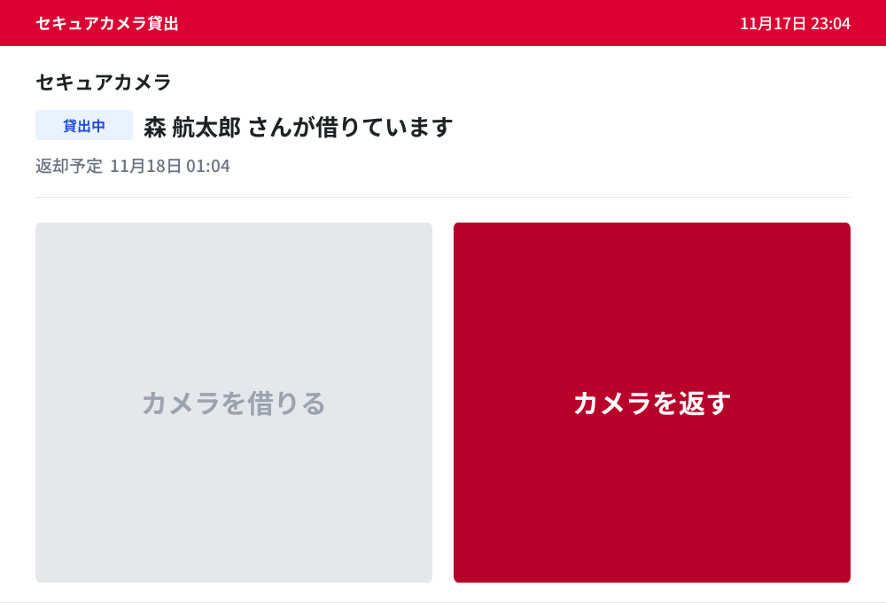
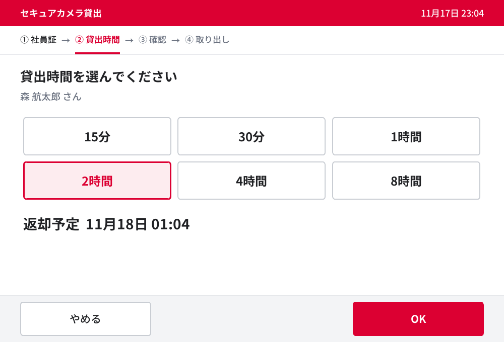
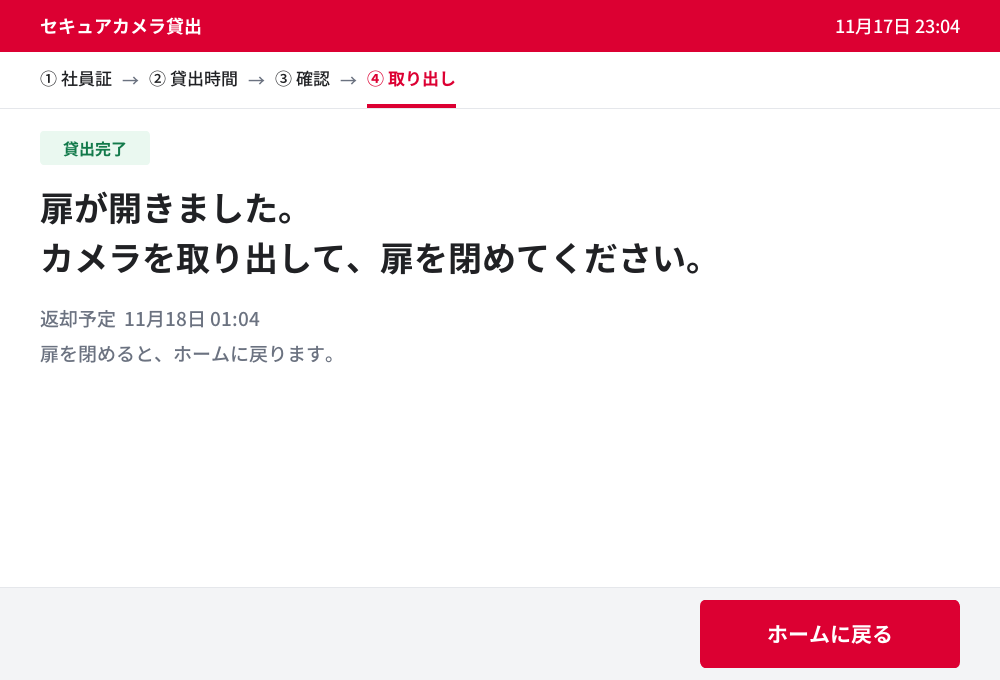
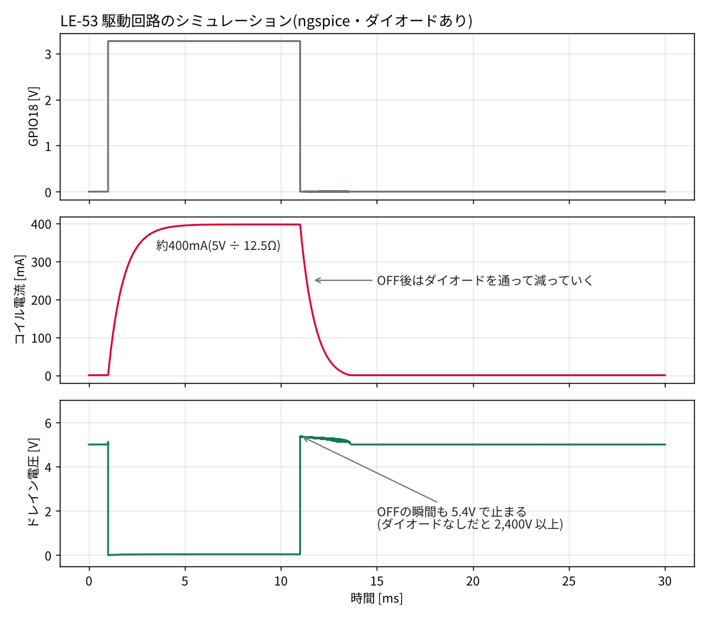

# セキュアカメラ貸出システム(MUST版)

社員証をかざして、登録されている人だけがセキュアカメラを借りられるようにするシステムです。
職場実践実習の課題として作りました(実運用はしていません)。

- 社員証(RC-S380)で本人確認。未登録のカードは借りられない
- 貸出時間を 15分 / 30分 / 1時間 / 2時間 / 4時間 / 8時間 から選ぶ
- 記録してから電磁ロック(LE-53)を開ける。記録に失敗したら開けない
- 扉が閉まった(施錠された)ことを LE-53 のマイクロスイッチで見つけて、ホームに戻る
- 誰が・いつ借りて・いつ返したかを SQLite に残す
- 貸出中は、借りている人と返却予定をホーム画面に出す
- 1分操作がなければホームに戻る

| ホーム | 貸出時間 | 完了 |
|---|---|---|
|  |  |  |

## PC で画面の流れだけ見る

本体(`main.py`)は、カードリーダーと電磁ロックがつながったラズパイで動かします。
PC で画面の流れだけを見せたいときは、`key_demo.py`(DB や機器を使わない簡易版)を使います。

```powershell
py -m venv .venv
.\.venv\Scripts\Activate.ps1
pip install -r requirements.txt
python key_demo.py
```

## 利用者の登録

```powershell
python register_user.py add 10002 "森 航太郎" 012E4CAA12345678
python register_user.py list      # 登録した人の一覧
python register_user.py history   # 貸出の記録
python register_user.py export    # 貸出の記録を CSV に保存(exports フォルダ)
```

カードIDは `python check_card_reader.py` で社員証を読むと表示されます。

## Raspberry Pi で動かす

```bash
sudo apt install python3-venv python3-tk python3-lgpio python3-gpiozero libusb-1.0-0 fonts-noto-cjk
python3 -m venv --system-site-packages .venv
source .venv/bin/activate
pip install -r requirements-pi.txt
python main.py
```

タッチモニターで使うときは `config.py` の `FULLSCREEN = True` にします(Esc で解除)。

### RC-S380 の準備

`python -m nfc` を実行して、表示される案内(udev ルールの追加など)に従います。
そのあと `python check_card_reader.py` で社員証が読めるか確認します。
同じ社員証を何回かかざして、毎回同じカードIDになることも確認してください。

### 電磁ロックの配線(安全のため必ず読む)

- 電磁ロックを Raspberry Pi の GPIO に直接つながない。リレーか MOSFET を通す
- 電磁ロックと並列にフライバックダイオードを入れる
- ロックの電源は Raspberry Pi とは別にする
- LE-53 は DC5V・約2W。一度通電するとラッチが外れ、扉を閉めると自動でロックがかかる。
  そのため本体は、5ms のパルスを1回出すだけにしている(実機では 2ms が最低限だった)。
  長さと回数は `config.py` の `UNLOCK_PULSE_...` で変えられる
- マイクロスイッチは NO を使い、COM を GND、NO を GPIO23 につなぐ(施錠中だけ導通)。スイッチに 5V はつながない
- 最初はロックをつながず、LED かテスターで `python check_lock.py` の出力を確認する
- リレーが Low で動くタイプなら `config.py` の `LOCK_ACTIVE_HIGH = False` にする
  (逆のままだと、普段は開いていて貸出のときだけ閉まる、という危険な動きになる)

### 駆動回路

`circuit/` に電磁ロックの駆動回路があります(NMOS で GND 側をスイッチする方式)。

- `lock_driver.asc` : LTspice の回路図
- `lock_driver_ngspice.cir` : 同じ回路の ngspice 用ネットリスト
- `lock_driver_sim.png` : シミュレーション結果

GPIO18 → 100Ω → NMOS のゲート、ゲートと GND の間に 10kΩ(起動中に勝手に開かないように)。
LE-53 は別電源の 5V と NMOS のドレインの間につなぎ、LE-53 と並列にダイオード(カソードを 5V 側)を入れます。
シミュレーションでは、OFF にした瞬間のドレイン電圧がダイオードありで 5.4V、なしだと 2,400V 以上になりました。

部品のモデルはシミュレーション用の汎用のものです。実際の部品は、3.3V で十分 ON になるロジックレベルの NMOS
(例: IRLML6344)と 1A のショットキーダイオード(例: 1N5819)を、データシートで確認して選んでください。
LE-53 のコイルは 12.5Ω(5V・2W から計算)と 10mH(仮の値)で表しています。



## 追加機能

MUST とは別に、1つの機能を1つのファイルに分けて足しています。
`config.py` の一番下で、機能ごとに ON / OFF できます(本体側は `if config.USE_〜:` の1行で呼ぶだけ)。

| 機能 | ファイル | 設定 | 内容 |
|---|---|---|---|
| 返却期限切れの表示 | `overdue_display.py` | `USE_OVERDUE_DISPLAY` | 期限を過ぎたら、ホームに「返却期限を過ぎています」を出す |
| 延滞の記録 | `overdue_record.py` | `USE_OVERDUE_RECORD` | 遅れて返したら完了画面に何分遅れたかを出す。履歴・CSV・Excel に「延滞(分)」が付く |
| 貸出の延長 | `extend.py` | `USE_EXTEND` / `EXTEND_MINUTES` | 借りた本人が社員証をかざすと、返却予定を延ばせる。期限を過ぎていたら今から延ばす |
| Excel 出力 | `excel_export.py` | (コマンドで使う) | `python excel_export.py` で履歴を `exports/` に .xlsx で保存。延滞した行は薄い赤 |
| DB のバックアップ | `backup.py` | `USE_BACKUP` / `BACKUP_KEEP_DAYS` | 1日1回 `backups/` に DB をコピー。14日分残す。`python backup.py` で今すぐ作れる |
| 管理画面 | `admin_screen.py` | `USE_ADMIN_SCREEN` | 管理者の社員証をかざすと、利用者の登録・一覧(削除)・履歴(Excel 保存)を画面から行える |

管理者は DB に登録します。最初の1人だけコマンドで登録し、2人目からは管理画面の登録で「管理者にする」にチェックします。

```powershell
python register_user.py admin 10001     # 社員番号 10001 の人を管理者にする
python register_user.py unadmin 10001   # 管理者をやめる
```

管理者が1人もいないときは、ホームに「管理者」のボタンは出ません。
管理画面の利用者登録では、社員番号と氏名をキーボードで入れます(USB キーボードをつなぐ)。
管理者は管理画面からは消せません(締め出されないように)。貸出の記録がある人を消したときは、
記録の名前が残るように、カードを使えなくするだけにしています。

## テスト

```powershell
python -m unittest
```

DB の記録、二重貸出の防止、記録に失敗したら扉を開けないこと、延滞の分数、延長、登録の削除、管理者の登録などを確認します(23件)。

## ファイル

| ファイル | 中身 |
|---|---|
| `main.py` | 起動 |
| `key_demo.py` | 顧客MTG用の画面デモ(画面の流れだけ。`gui_parts.py` も一緒に必要) |
| `config.py` | 設定(貸出時間の選択肢、GPIO番号など) |
| `gui.py` | ウィンドウ(画面の切り替え、時計、エラー表示) |
| `screens.py` | 各画面 |
| `gui_parts.py` | 色・文字・ボタンなどの部品と、画面の土台 |
| `db.py` | SQLite の読み書き |
| `card_reader.py` | 社員証の読み取り |
| `lock.py` | 電磁ロックの制御 |
| `register_user.py` | 利用者の登録 |
| `check_card_reader.py` / `check_lock.py` | 機器だけの動作確認 |
| `check_lock_pulse.py` | パルスの長さ・回数を変えて、ロックが外れるかを試す |
| `check_switch.py` | LE-53 のマイクロスイッチ(施錠中かどうか)の確認 |
| `overdue_display.py` / `overdue_record.py` / `extend.py` | 追加機能(延滞の表示・記録、延長) |
| `excel_export.py` / `backup.py` / `admin_screen.py` | 追加機能(Excel 出力、バックアップ、管理画面) |
| `circuit/` | 電磁ロックの駆動回路(LTspice) |

## まだやっていないこと

- 追加機能を実機で通しで動かす確認(PC の画面では確認済み。MUST の部分は実機で確認済み)
- 複数のカメラへの対応(顧客と相談してから)
- 返却期限切れを音で知らせる(顧客と相談してから)
